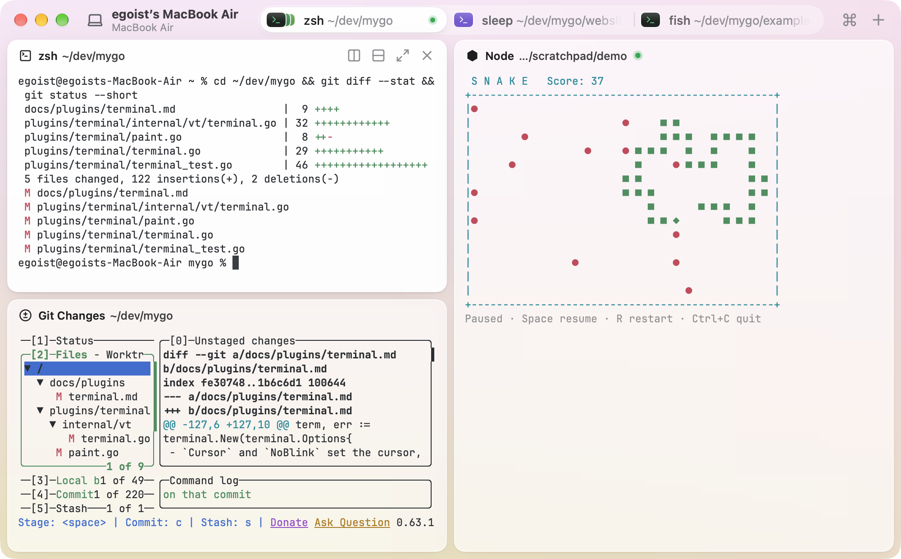

# GoRex

A replica of [Superlogical's Rex](https://www.superlogical.com/updates/public-testing-beginning)
terminal, written in Go with [MyGo](https://mygo.egoist.dev)'s native UI and its
terminal plugin (Ghostty's libghostty-vt). No webview, no cgo: one ~14 MB app.

Unlike the original, which is macOS-only, GoRex runs wherever MyGo does —
and instead of a session server of its own it talks to **the real Rex
server** (`rex server`), the same one Rex.app and the `rex` CLI use. That
means panes it opens live in actual Rex sessions: they can be seen,
scripted and shared by every other Rex client, and they outlive the app.



## What it does

- **Tabs and split panes.** Every pane is a card over the window's gradient,
  with its program's icon, name and directory in its header, and buttons to
  split right, split down, zoom and close. Drag the gaps between panes to
  resize them (double-click resets a split to half). Each tab is a Rex
  window, each pane a Rex block, each divider a Rex split: the layout the
  app draws is `session.view`, and changes made by other clients — Rex.app,
  the `rex` CLI, Lua scripts — show up live.
- **Persistent sessions.** Shells run in the Rex session server. Quit
  GoRex and everything keeps running; open it again and every window,
  split and pane comes back as it was, programs still running. Attaching
  opens a data stream whose snapshot — Ghostty's, decoded with the same
  libghostty-vt the terminal uses — restores the screen with its
  scrollback, so full-screen programs (lazygit, vim, htop…) come back
  exactly.
- **Program activity.** The server's `process_changed` events name each
  terminal's foreground process: headers and tabs show the program
  (`Node`, `Git Changes` for lazygit, `Codex`, `SSH host`…) and its
  working directory, a green dot shows a program printing, and an orange
  dot marks a pane whose program finished or rang the bell out of sight.
  When the window is in the background, a long command finishing posts a
  notification.
- **Tab icons** stack the tiles of a tab's programs, the focused pane's in
  front, as Rex does. Tabs reorder by dragging (`session.move_window`),
  rename by double-click (`session.set_window_label`), and have a context
  menu.
- **Host chip** with the machine's name and OS; its popover shows the
  server's PID, uptime and API revision.
- **Command palette** (⇧⌘P, Ctrl+Shift+P, or the ⌘ button): every command,
  and every pane to jump to, fuzzy-matched.
- **Reconnects.** If the control connection drops, the app resumes the
  client the server kept (`reconnect_token`), reads the view again, and
  re-opens every pane's data stream, which restores each terminal from a
  fresh snapshot.
- Light and dark appearances (View ▸ Appearance), text size (⌘+ ⌘− ⌘0),
  JetBrains Mono embedded.

## Shortcuts

| macOS | Windows, Linux | |
|---|---|---|
| ⌘T | Ctrl+Shift+T | New tab |
| ⌘D / ⇧⌘D | Ctrl+Shift+D / Ctrl+Shift+E | Split right / down |
| ⌘W / ⇧⌘W | Ctrl+Shift+W | Close pane / tab |
| ⇧⌘↩ | Ctrl+Shift+Enter | Zoom the pane |
| ⌥⌘ arrows | Alt+arrows | Focus the pane in that direction |
| ⌃⌘ arrows | Alt+Shift+arrows | Move the nearest divider |
| ⌃⌘= | | Equalize panes |
| ⌘1…⌘9, ⇧⌘[ ⇧⌘], ⌃Tab | Ctrl+Shift+1…9, Ctrl+PageUp/PageDown, Ctrl+Tab | Switch tabs |
| ⇧⌘R | Ctrl+Shift+R | Rename tab |
| ⇧⌘P, ⌘P | Ctrl+Shift+P | Command palette |
| ⌘K | Ctrl+Shift+K | Clear |
| ⌘+ ⌘− ⌘0 | Ctrl+= Ctrl+- Ctrl+0 | Text size |
| ⌥⌘Q | | Quit and end the session |

Elsewhere than on macOS, Control and a letter are the terminal's (Ctrl+C,
Ctrl+D, Ctrl+W…), so GoRex's shortcuts take Shift too, as copying and
pasting do (Ctrl+Shift+C, Ctrl+Shift+V), and none take Control and Alt,
which type characters (AltGr) on many keyboards.

## Run it

GoRex needs a running Rex server — install [Rex](https://pkgs.superlogical.com/rex)
and start it once:

```sh
rex server start
```

Then run the app:

```sh
go run .              # straight from the repository
```

The app attaches to the first session the server has, or creates one
labeled `gorex` with a shell window when there is none. `REX_SOCKET`
names another server's socket; the default is
`$XDG_RUNTIME_DIR/rex/server.sock`.

### A remote server

GoRex connects to a server on another machine the way rex's `-S` does:

```sh
gorex --server rex.example.ts.net    # or --server host:port, or a URL
REX_SERVER=rex.example.ts.net gorex  # the same, from the environment
```

The first connection that succeeds is remembered in the settings, so the
option is needed once. A server address takes these forms:

- **a bare host** or **host:port** — probed as HTTPS, then HTTPS on
  Rex's tailnet port 7297, then plain TCP on it. Spell a tailnet server
  by its MagicDNS name (`rex.example-tailnet.ts.net`): its certificate
  is a real one for that name, so the TLS handshake needs it, and an IP
  fails. This machine must be on the tailnet too.
- **https://host** / **http://host:port** — the scheme decides TLS
  without probing.
- **unix:///path** or a bare path — a Unix socket, as the local default.

On the server side, expose the API with either:

```sh
rex server tailscale on                              # over the tailnet, TLS on 443
rex server run --extra-listen http://0.0.0.0:7297 --allow-anonymous   # plain TCP (trusted networks only)
```

The tailnet way is the safe one: WireGuard encrypts the transport, the
node's owner authenticates by Tailscale identity, and
`--allow-anonymous` gives every caller full access — use it only on a
network you trust.

## Develop and build

GoRex needs [Go](https://go.dev/dl/) 1.27+ and MyGo 0.3.0, whose CLI
`go.mod` pins as a tool:

```sh
go tool mygo dev     # GoRex Dev, rebuilt and restarted as the code changes
go test ./...        # unit tests, and live ones when a server is running
go tool mygo build   # build/linux-amd64/: binary, .deb, tarball, install.sh
go run ./tools/mkicon  # redraw resources/icon.png
```

The live tests create their own `gorex-test` sessions on the running
server and skip when there's no socket. `GOREX_DIR` names another
settings directory.

## Layout

| | |
|---|---|
| `main.go` | the app, its window, connecting and joining the session |
| `state.go` | the mirror of `session.view`: tabs, splits and panes, and the event loop that keeps them in step |
| `view.go`, `tabs.go`, `host.go`, `commands.go` | the interface: title bar, tabs, panes, host popover, menus and palette |
| `programs.go` | how programs show: names, glyphs, tile colors |
| `style.go`, `settings.go` | colors, fonts, terminal themes; appearance and text size |
| `internal/rex` | the Rex API client: the control connection, `session.view`, block methods, the terminal data stream and its GHOSTSNP snapshot decoding via libghostty-vt |

Not implemented: floating layers and minimized windows (the view draws
only tiled layers), `client.key` scripts and Lua, the `target.*` RPCs,
Tailscale logins, prompts (`client_prompt`), and resuming a data
connection mid-stream — a dropped stream starts over from a snapshot
instead of a byte count.

Icons: [Lucide](https://lucide.dev) (ISC) and [Simple Icons](https://simpleicons.org)
(CC0). Font: [JetBrains Mono](https://www.jetbrains.com/lp/mono/) (OFL).
